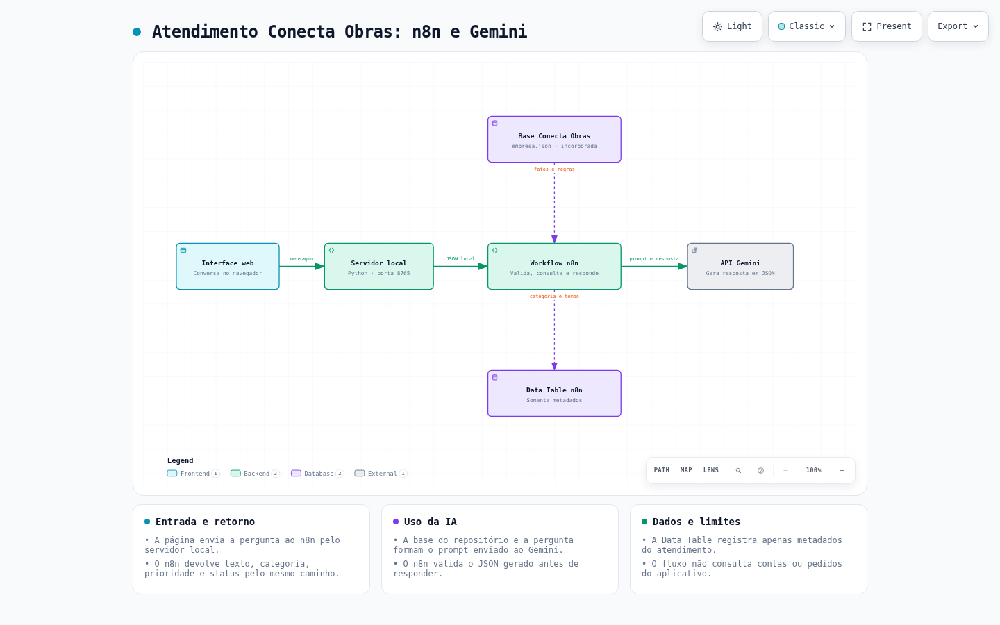

# Atendimento Conecta Obras com n8n e Gemini

    

## Propósito

Este projeto é um **MVP de atendimento automatizado** para tirar dúvidas sobre o uso da plataforma Conecta Obras: busca de profissionais, solicitações de serviço, negociação de orçamento e abertura de chamados. Ele usa fatos e regras extraídos do [repositório Conecta Obras](https://github.com/jhonatan-gonzaga/conectaObras/tree/develop) para orientar as respostas. O assistente não contrata profissionais, não calcula preços e não acessa dados de usuários do aplicativo.

[Abrir o diagrama interativo da arquitetura](docs/arquitetura-interativa.html) · [Ver o fluxo técnico](docs/arquitetura.md)

## Vídeo de apresentação

https://github.com/user-attachments/assets/c5fd637f-4279-458c-a2c4-2e789003aa75

O vídeo mostra uma conversa de demonstração, o caminho da mensagem pela interface, n8n e Gemini e como adaptar a automação para outra empresa. A conversa não é uma gravação de atendimento real.

Música: Sascha Ende, [ende.app (CC BY 4.0)](https://ende.app/en/standard-license).

## Arquitetura



## Como a automação usa IA

1. A pessoa envia uma pergunta pela interface web local ou diretamente ao Webhook do n8n. A interface passa pelo servidor Python local; ela não chama o Gemini.
2. O workflow do **n8n** valida a entrada e monta um prompt com a pergunta e a [base de conhecimento](knowledge/empresa.json), que foi incorporada ao workflow quando o export foi gerado.
3. A **API Gemini** gera um texto de resposta e sugere `category` e `priority`. As instruções pedem que ela use apenas fatos da base e admita quando não souber algo; a classificação é uma sugestão do modelo, não uma decisão comercial automática.
4. O **n8n** confere se o JSON recebido contém os campos e valores permitidos, registra apenas metadados na Data Table e devolve a resposta à pessoa. Em caso de entrada inválida ou falha da API, devolve um erro adequado.

O Gemini **não foi treinado com o repositório** e não o consulta durante a conversa. A base é uma cópia preparada do commit `c4570721` da branch `develop`; mudar esse arquivo exige gerar o workflow novamente e publicar a versão atualizada no n8n. Cada pergunta é independente: não há memória de conversa nem consulta a contas, pedidos ou disponibilidade em tempo real.

## Reaproveitar para outra empresa

O **núcleo da automação é reutilizável** para atendimento informativo de outras empresas: a lógica do n8n e do Gemini permanece a mesma. Para adaptar as respostas, substitua os fatos, as regras de negócio e as perguntas frequentes em [`knowledge/empresa.json`](knowledge/empresa.json) pelas informações aprovadas da nova empresa. Inclua somente dados que possam ser enviados à API Gemini e apresentados aos clientes.

Depois de editar o JSON, execute `python3 scripts/build_workflows.py`, teste com `node --test tests/workflow.test.js` e atualize e publique `workflows/atendimento-gemini.json` no n8n. **Editar o JSON sozinho não altera o workflow ativo**, pois a base é incorporada ao arquivo gerado. Se usar a interface web, adapte também o nome, a saudação e as perguntas sugeridas em `web/index.html`, que ainda exibem Conecta Obras.

## Arquivos

- `workflows/atendimento-gemini.json`: fluxo principal importável.
- `workflows/teste-gemini.json`: teste manual de conexão com a API.
- `knowledge/empresa.json`: fatos e regras da plataforma Conecta Obras, extraídos da branch `develop` do [repositório](https://github.com/jhonatan-gonzaga/conectaObras/tree/develop).
- `src/`: código dos nós Code; `scripts/build_workflows.py` incorpora a base e regenera os exports.
- `scripts/check-gemini.py`: lista modelos liberados e testa `generateContent`.
- `scripts/check-network.sh`: DNS, HTTPS, Docker e logs.
- `scripts/test-webhook.sh`: teste HTTP local.
- `scripts/serve-web.py` e `web/index.html`: interface de mensagens local.
- `tests/workflow.test.js`: testes sem chave nem rede.
- `tests/test_web.py`: teste do servidor web local.
- `docs/arquitetura-interativa.html` e `docs/arquitetura.archify.json`: diagrama interativo e sua especificação Archify.
- `docker/compose.yaml`: exemplo para instalação nova; não substitui o Compose existente.

## Requisitos

Python 3, Node.js 18+ para os testes, n8n Community Edition com nós Webhook, Code, If, HTTP Request e Respond to Webhook, e uma chave da [Gemini API](https://ai.google.dev/api). Docker Compose é necessário somente para uma instalação nova.

A instância local usa n8n Community Edition **2.47.7** e responde em `http://127.0.0.1:5678`. Ela já contém outro workflow Gemini, que foi preservado. O export usa HTTP Request 4.2, Code 2, If 2.2, Data Table 1.1 e Respond to Webhook 1.4. Confira a compatibilidade desses nós ao importar em outra versão.

Nesta instância, os workflows **Atender clientes com Gemini** (ativo) e **Testar conexão com Gemini** (manual) já foram criados, com a credencial no cofre do n8n. O fluxo ativo foi atualizado e publicado com a base Conecta Obras; o Webhook de produção respondeu HTTP 200 para perguntas sobre orçamento, suporte e horário desconhecido. A Data Table registra categoria, prioridade e tempo de processamento. Veja [instalação](docs/instalacao.md) para repetir a validação.

## Instalação na instância existente

1. Dentro deste diretório, execute `python3 scripts/build_workflows.py` e `node --test tests/workflow.test.js`.
2. Execute `python3 scripts/check-gemini.py` e digite a chave no prompt. Confirme um modelo que liste `generateContent`. `python3 scripts/check-gemini.py --smoke` também testa uma geração JSON. O export usa `gemini-3.5-flash-lite`, confirmado nesta sessão. Para trocar, mude apenas `MODEL` em `scripts/build_workflows.py` e regenere os dois exports.
3. No n8n, crie uma credencial **Header Auth** com nome do cabeçalho `x-goog-api-key` e valor igual à chave Gemini. Não adicione a chave ao JSON exportado, ao Compose ou a `.env`.
4. No projeto pessoal do n8n, crie uma **Data Table** chamada `atendimento_mvp` com as colunas `sessionId`, `category`, `priority`, `status`, `timestamp` (texto) e `processingMs` (número). A tabela já existe nesta instância. Em outra instância, substitua `TABLE_ID` em `scripts/build_workflows.py` pelo ID da nova tabela e gere novamente os exports; a seleção da tabela usa o ID local.
5. Importe `workflows/teste-gemini.json` em **Add workflow → Import from file**. No nó **Testar Gemini**, selecione a credencial e execute manualmente. Confirme HTTP 200 e `candidates` na saída.
6. Importe `workflows/atendimento-gemini.json`. Selecione a mesma credencial nos nós **Consultar Gemini** e **Repetir Gemini**. Revise as conexões e salve. Ative/publicar o workflow depois de testar os nós. Os exports são importados inativos.
7. Use o Webhook de teste na interface enquanto o editor estiver ouvindo. Para chamadas persistentes, use o Webhook de produção após ativar o fluxo.

As credenciais são escolhidas por nó. Verifique as três seleções, especialmente se houver várias chaves no n8n.

## Chamada e resposta

```bash
curl -i --max-time 55 'http://127.0.0.1:5678/webhook/atendimento-empresarial' \
  -H 'Content-Type: application/json' \
  -d '{"sessionId":"cliente-001","message":"Como encontro um profissional?"}'
```

Resposta esperada, com texto gerado pela IA:

```json
{
  "sessionId": "cliente-001",
  "category": "duvida_geral",
  "priority": "baixa",
  "response": "No aplicativo, busque profissionais por categoria e consulte seus perfis, portfólios e avaliações.",
  "status": "success"
}
```

`category` pode ser `duvida_geral`, `orcamento`, `reclamacao`, `suporte_tecnico` ou `outros`; `priority` pode ser `baixa`, `media` ou `alta`. Entrada inválida retorna HTTP 400; falha da API ou resposta inválida retorna HTTP 502/503 com `status: error`.

O caminho `/webhook-test/atendimento-empresarial` só funciona enquanto o editor aguarda um evento de teste. `bash scripts/test-webhook.sh` usa o caminho de produção; para testar no editor, use `WEBHOOK_PATH=webhook-test/atendimento-empresarial bash scripts/test-webhook.sh`.

## Interface web local

Com o n8n ativo, rode em outro terminal:

```bash
cd ~/Área\ de\ trabalho/n8n/n8n-ai-atendimento
python3 scripts/serve-web.py
```

Abra **http://127.0.0.1:8765**. A página envia as mensagens ao mesmo workflow já ativo, mostra a resposta e a classificação e fica acessível somente neste computador. Não precisa configurar a chave Gemini no navegador. Cada pergunta é processada separadamente pelo MVP; a tela mostra apenas as mensagens da aba atual e não guarda histórico no navegador. Pare o servidor com `Ctrl+C`.

O servidor local encaminha apenas JSON para o Webhook em `127.0.0.1:5678` e evita problemas de CORS no navegador. Ele não tem login de usuários; mantenha-o restrito a localhost.

## Base de conhecimento e classificação

Edite `knowledge/empresa.json`, execute `python3 scripts/build_workflows.py` e reimporte/atualize o workflow. A base está embutida no nó **Validar e preparar**, para que o fluxo não dependa de um arquivo montado no container. A mensagem do cliente é tratada como dado; o prompt pede que o modelo recuse fatos ausentes. O nó **Validar resposta** rejeita categorias, prioridades e JSON fora do contrato.

A base atual foi preparada a partir do commit `c4570721` da branch `develop`: [visão geral](https://github.com/jhonatan-gonzaga/conectaObras/blob/develop/TP4-mvp/README.md), [regras de contratação e pagamentos](https://github.com/jhonatan-gonzaga/conectaObras/blob/develop/TP4-mvp/docs/Termos%20de%20Uso%20e%20Pol%C3%ADtica%20de%20Privacidade/Termos_de_Uso_Conecta_Obra_Itacoatiara.md), [jornada de clientes](https://github.com/jhonatan-gonzaga/conectaObras/blob/develop/TP4-mvp/docs/rastreabilidade-cliente.md), [lojas](https://github.com/jhonatan-gonzaga/conectaObras/blob/develop/TP4-mvp/docs/onboarding-loja.md) e [suporte](https://github.com/jhonatan-gonzaga/conectaObras/blob/develop/TP4-mvp/docs/persona-suporte.md). O atendimento explica essas regras; não consulta o banco de dados do aplicativo nem realiza ações por ele. Não há horário de atendimento, preços ou disponibilidade individual confirmados nessa base.

O `sessionId` é um identificador técnico, não memória de conversa. Este MVP não mantém histórico de diálogo, não envia notificações externas e não toma decisões comerciais automaticamente.

## Erros e limites de tempo

O HTTP Request usa timeout de 10 s. Falhas de transporte são repetidas até uma vez pelo nó, com 1,5 s de intervalo. HTTP 500/502/503/504 recebe mais uma tentativa após 2 s. HTTP 401/403, 404 e 429 não são repetidos; o cliente recebe mensagem clara. A execução tem limite de 55 s. O teste Webhook também usa `--max-time 55`.

O registro usa a Data Table local `atendimento_mvp` para guardar `sessionId`, categoria, prioridade, status, timestamp e tempo em milissegundos. Não guarda o texto da mensagem nem a resposta. Se a inserção falhar, o Webhook devolve HTTP 503. O export desativa gravação de dados de execução em sucesso e erro. [Data Tables](https://docs.n8n.io/build/work-with-data/data-tables/) são adequadas para volume leve ou moderado; nesta instalação o limite padrão é 200 MiB.

## Testes e métricas

```bash
node --test tests/workflow.test.js
python3 -m unittest discover -s tests -p 'test_web.py'
docker compose -f docker/compose.yaml config --quiet
bash scripts/check-network.sh
bash scripts/test-webhook.sh
```

Os testes locais cobrem entrada válida/vazia, orçamento, reclamação, pergunta fora da base, API indisponível, timeout, modelo inválido e JSON inválido. Os casos de classificação simulam respostas do Gemini; para medir a qualidade real, envie um conjunto rotulado de mensagens pelo Webhook e compare as categorias retornadas com os rótulos esperados.

- **Tempo médio:** média de `processingMs` das linhas da Data Table no período.
- **Acurácia de classificação:** respostas com categoria igual ao rótulo humano ÷ total de mensagens rotuladas.
- **Taxa de erros:** registros com `status: error` ÷ total de registros.

Exporte a tabela como CSV na interface do n8n para calcular as métricas por período. Os testes de API ao vivo dependem de chave, cota, rede e credencial configurada no n8n; não trate os testes unitários como prova de execução ponta a ponta.

## Docker e segurança

O arquivo `docker/compose.yaml` serve apenas para uma instalação nova e vincula a interface a `127.0.0.1`. A instalação existente usa `network_mode: host` e volume `n8n_data`; não execute um segundo Compose na porta 5678 nem recrie o volume. O Compose existente teve a indentação e a grafia de `NODE_OPTIONS=--dns-result-order=ipv4first` corrigidas; o usuário recriou o container e confirmou o Webhook com HTTP 200.

Mantenha o Webhook restrito a localhost durante o desenvolvimento. Se for exposto à rede, adicione autenticação e limite de requisições antes de aceitar mensagens reais. A chave e a senha fornecidas nesta conversa não foram gravadas no projeto. Por terem sido compartilhadas no chat, rotacione-as após configurar as credenciais no n8n.

Consulte [arquitetura](docs/arquitetura.md), [instalação](docs/instalacao.md) e [solução de problemas](docs/troubleshooting.md) para detalhes.

## Evoluções possíveis

Migrar a base de conhecimento para uma Data Table, adicionar autenticação ao Webhook, revisar respostas de reclamações por uma pessoa e criar testes de qualidade com mensagens rotuladas.
